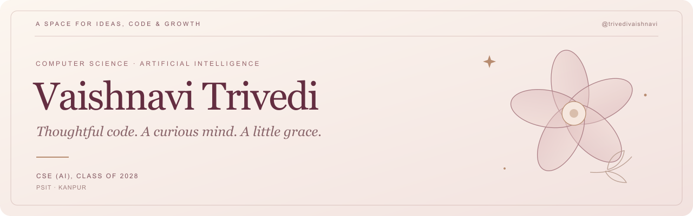

  

  <a href="https://www.linkedin.com/in/vaishnavi-trivedi-csai/">LinkedIn</a> &nbsp;·&nbsp;
  <a href="https://github.com/trivedivaishnavi?tab=repositories">Explore my work</a> &nbsp;·&nbsp;
  <a href="https://fem-care-ai-dun.vercel.app/">FemCare AI demo</a>

## A little about me

I'm **Vaishnavi**, a Computer Science undergraduate specializing in Artificial Intelligence at **Pranveer Singh Institute of Technology, Kanpur** (2024–2028).

I enjoy turning a problem into something people can use: a clear interface, a useful dashboard, or a small experiment that helps me understand the data. I'm developing my skills through projects, C++ problem-solving, and team hackathons.

- **Building:** web applications and data-focused projects.
- **Strengthening:** data structures, algorithms, and software fundamentals.
- **Exploring:** practical machine learning and explainable systems.
- **Beyond code:** team leadership, presentations, and anchoring college events.

## Selected work

<table>
<tr>
<td width="50%" valign="top">

### 01 / FemCare AI

A women's health prototype with cycle and symptom tracking, rule-based awareness scoring, weighted cycle forecasts, and printable appointment summaries.

**React · TypeScript · Tailwind CSS · Vite**

[Repository](https://github.com/trivedivaishnavi/FemCare-AI) · [Live demo](https://fem-care-ai-dun.vercel.app/)

</td>
<td width="50%" valign="top">

### 02 / Air Quality Forecasting

An experimental project exploring spatial AQI estimation with graph attention and temporal forecasting with LSTM models, alongside visualizations and a city dashboard.

**Python · TensorFlow · PyTorch Geometric**

[Repository](https://github.com/trivedivaishnavi/AQI-prediction-system)

</td>
</tr>
<tr>
<td width="50%" valign="top">

### 03 / WorkTruth

A team project exploring evidence-based infrastructure review through financial, geospatial, visual, textual, and temporal checks. My focus included team leadership and coordinating technical execution.

**React · TypeScript · Node.js · PostgreSQL**

[Project repository](https://github.com/trivedivaishnavi/WorkTruth-Evidence-Platform) · [Live demo](https://worktruth-rust.vercel.app/)

</td>
<td width="50%" valign="top">

### 04 / DSA Practice

My space for practicing data structures and algorithms in C++, comparing approaches, and building a more consistent problem-solving habit.

**C++ · Data structures · Algorithms**

[Practice repository](https://github.com/trivedivaishnavi/DSA-Practice)

</td>
</tr>
</table>

## My working toolkit

These are tools I've used in coursework or projects; I'm still building depth through practice.

| Area | Current focus |
| --- | --- |
| Programming | Python, C++, JavaScript, TypeScript |
| Web development | React, HTML, CSS, Tailwind CSS |
| Data and ML | Data preprocessing, basic model evaluation, TensorFlow/PyTorch project workflows |
| Databases | SQL fundamentals; project exposure to PostgreSQL and SQLite |
| Everyday tools | Git, GitHub, VS Code, Jupyter Notebook |
| Foundations | DSA, OOP, DBMS, and operating systems coursework |

## Learning, leading, showing up

- **Smart India Hackathon 2026:** team leader; internal-round finalist.
- **ProTech 2K25:** finalist, team leader, and team representative.
- **Flipkart Grid 8.0:** shortlisted for Round 2.
- **Bharat ISRO Hackathon 2026:** led a four-member team for a space-technology challenge.
- **Ignitia annual fest:** head anchor for two consecutive years.

I've also completed introductory learning through **Cisco Networking Academy** and **TCS iON** in AI and cybersecurity awareness.

---

  <strong>Building with intention. Learning as I go.</strong> 
  Interested in building something useful together? <a href="https://www.linkedin.com/in/vaishnavi-trivedi-csai/">Let's connect.</a>

